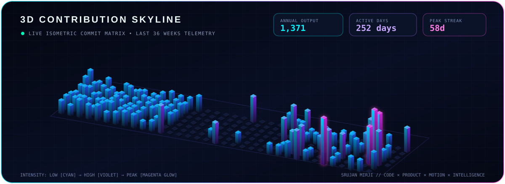
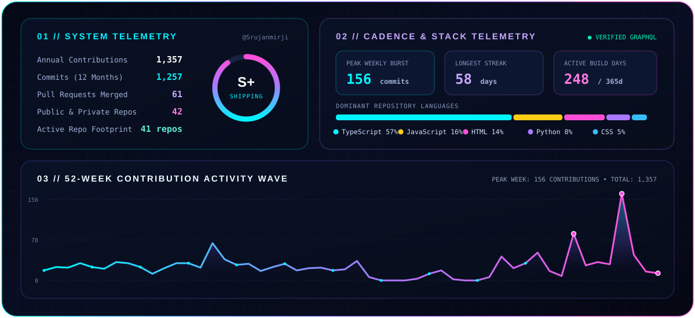

<div align="center">



<br />

<a href="https://port1-hazel-seven.vercel.app"></a>
<a href="https://www.linkedin.com/in/srujanmirji"></a>
<a href="https://x.com/srujanmirji10"></a>
<a href="https://instagram.com/srujan_mirji"></a>
<a href="mailto:Srujanmirji10@gmail.com"></a>
<a href="https://github.com/Srujanmirji?tab=repositories"></a>

<br /><br />


</div>

<br />

## `01 // SYSTEM PROFILE`

```ts
const srujan = {
  role: "Full-Stack Developer & AI Product Builder",
  degree: "B.Tech CSE",
  coordinates: "India 🇮🇳",
  coreStack: ["TypeScript", "Next.js", "Python", "FastAPI", "Java", "Spring Boot"],
  currentQuest: ["Agentic AI Systems", "Spring Boot + System Design", "DSA", "Docker", "PostgreSQL"],
  buildZones: ["Multi-Agent AI", "Mission-Control Web Apps", "3D Web (WebGL)", "Native macOS & Android"],
  operatingPrinciple: "Make it useful. Make it fast. Make it unforgettable.",
};
```

I build across the stack—from autonomous AI workflows, financial & weather intelligence pipelines, and backend APIs to cinematic product interfaces. My work spans **human-in-the-loop AI agents**, **scientific & disaster-forecasting consoles (SIH 2026)**, **native macOS and Android apps**, and **full-stack platforms**.

> **Current signal:** shipping high-reliability agentic systems, sharpening Java + Spring Boot & system design, and building startup-grade products where AI, FinTech, and real-time engineering collide.

<br />

## `02 // SELECTED BUILDS`

<table>
  <tr>
    <td width="50%" valign="top">
      <h3>🧾 <a href="https://github.com/Srujanmirji/MINEARENA">AuditLoop (MineArena)</a></h3>
      <p>Human-in-the-loop financial filing auditor agent for SEC 10-K statements that verifies metrics against XBRL ground truth with <b>96.6% accuracy</b>, <b>0 wrong auto-approvals</b>, and <b>24/24 E2E tests</b>.</p>
      <p><code>Python</code> <code>Agentic AI</code> <code>SEC XBRL</code> <code>Pytest</code></p>
      <p><a href="https://github.com/Srujanmirji/MINEARENA"><code>[Source &amp; Report ↗]</code></a></p>
    </td>
    <td width="50%" valign="top">
      <h3>🛰️ <a href="https://github.com/Srujanmirji/VAJRA">VAJRA (वज्र) — SIH 2026</a></h3>
      <p>Multi-source convective nowcasting system (0–6h) for thunderstorms, hail, and cloudbursts built for <b>NCMRWF &amp; Ministry of Earth Sciences</b> (PS-26084).</p>
      <p><code>TypeScript</code> <code>Next.js</code> <code>GeoSpatial AI</code> <code>Mission Control</code></p>
      <p><a href="https://vajra-ivory.vercel.app/console"><code>[Live Forecaster Console ↗]</code></a> &nbsp;·&nbsp; <a href="https://github.com/Srujanmirji/VAJRA"><code>[Repo ↗]</code></a></p>
    </td>
  </tr>
  <tr>
    <td width="50%" valign="top">
      <h3>🌀 <a href="https://github.com/Srujanmirji/aegisAI">AegisAI</a></h3>
      <p>Enterprise multi-agent AI copilot wrapped around a real-time WebGL Schwarzschild black-hole core.</p>
      <p><code>Three.js</code> <code>GLSL</code> <code>FastAPI</code> <code>LangGraph</code></p>
      <p><a href="https://aegis-ai-bay.vercel.app"><code>[Live Demo ↗]</code></a> &nbsp;·&nbsp; <a href="https://github.com/Srujanmirji/aegisAI"><code>[Repo ↗]</code></a></p>
    </td>
    <td width="50%" valign="top">
      <h3>🪐 <a href="https://github.com/Srujanmirji/LiveWall">LiveWall</a></h3>
      <p>Native, performance-focused live wallpaper engine for macOS with multi-monitor control and zero-lag video playback.</p>
      <p><code>Swift 6</code> <code>SwiftUI</code> <code>AppKit</code> <code>AVFoundation</code></p>
      <p><a href="https://live-wall-mauve.vercel.app"><code>[Product Site ↗]</code></a> &nbsp;·&nbsp; <a href="https://github.com/Srujanmirji/LiveWall"><code>[Repo ↗]</code></a></p>
    </td>
  </tr>
  <tr>
    <td width="50%" valign="top">
      <h3>👁️ <a href="https://github.com/Srujanmirji/SmartVisionAssist">SmartVisionAssist</a></h3>
      <p>Offline Android accessibility assistant with real-time object detection, distance estimation, speech synthesis, and tactile haptics.</p>
      <p><code>Kotlin</code> <code>CameraX</code> <code>TensorFlow Lite</code> <code>YOLOv8</code></p>
      <p><a href="https://github.com/Srujanmirji/SmartVisionAssist"><code>[Repo ↗]</code></a></p>
    </td>
    <td width="50%" valign="top">
      <h3>⚡ <a href="https://github.com/Srujanmirji/Codewick">SkillSwap</a></h3>
      <p>Time-credit skill marketplace with trust bootstrapping, real-time messaging, wallets, and AI-assisted dispute resolution.</p>
      <p><code>Next.js 15</code> <code>MongoDB</code> <code>NextAuth</code> <code>Framer Motion</code></p>
      <p><a href="https://codewick-mauve.vercel.app"><code>[Live App ↗]</code></a> &nbsp;·&nbsp; <a href="https://github.com/Srujanmirji/Codewick"><code>[Repo ↗]</code></a></p>
    </td>
  </tr>
</table>

> **More Recent Shipments:** &nbsp;🌩️ [**MEGHA-DRISHTI**](https://github.com/Srujanmirji/MEGHA-DRISHTI) ([Live Workstation ↗](https://sih-phi-ashy.vercel.app) — AI 5km extreme weather downscaling for IMD/NCMRWF) &nbsp;·&nbsp; 🚘 [**EVONE**](https://github.com/Srujanmirji/EV_ONE) (Web-first EV catalogue, savings engine & comparison ecosystem) &nbsp;·&nbsp; 🏛️ [**CampusHR JCET**](https://github.com/Srujanmirji/CampusHR_JCET) (HOD-approved faculty & HR management platform)

<div align="center">
  <a href="https://github.com/Srujanmirji?tab=repositories"></a>
</div>

<br />

## `03 // TECH CONSTELLATION`

<div align="center">


<br /><br />


<br /><br />

`FRONTEND & 3D` **React · Next.js · TypeScript · Three.js** &nbsp;·&nbsp; `BACKEND & AI` **FastAPI · Spring Boot · Node.js · LangGraph** &nbsp;·&nbsp; `DATA & INFRA` **PostgreSQL · MongoDB · Supabase · Docker**

</div>

<br />

## `04 // 3D BUILD DIMENSION`

<div align="center">



<sub>Live 36-week isometric commit skyline generated directly from GitHub GraphQL telemetry and auto-updated daily via GitHub Actions.</sub>

</div>

<br />

## `05 // DEVELOPER TELEMETRY`

<div align="center">



</div>

<br />

## `06 // OPEN CHANNEL`

<div align="center">

I’m interested in **bold software ideas, startup-grade products, agentic AI systems, and beautifully engineered interfaces**.

If that sounds like your frequency, let's build together.

<br />

<a href="https://port1-hazel-seven.vercel.app"></a>
<a href="https://www.linkedin.com/in/srujanmirji"></a>
<a href="mailto:Srujanmirji10@gmail.com"></a>

<br /><br />


<sub><code>CODE × PRODUCT × MOTION × INTELLIGENCE</code></sub>

</div>
